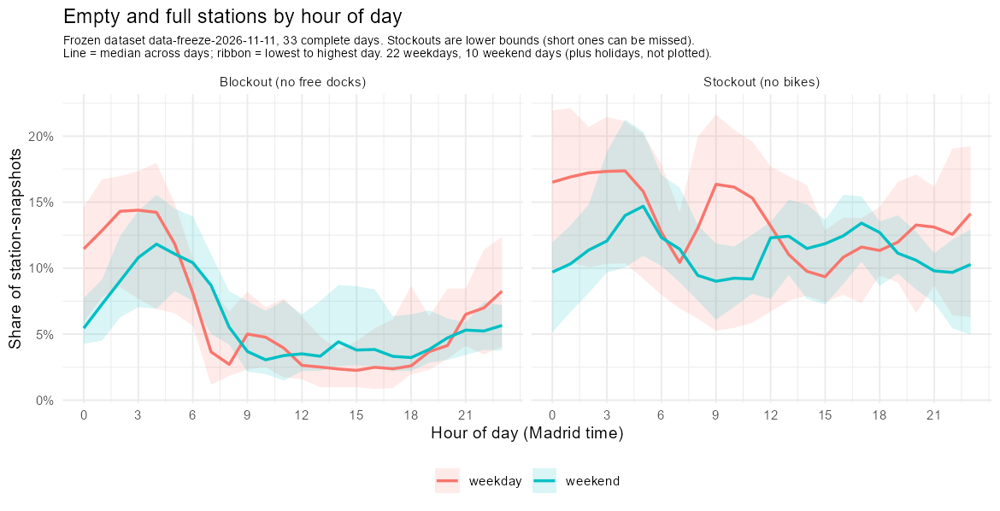
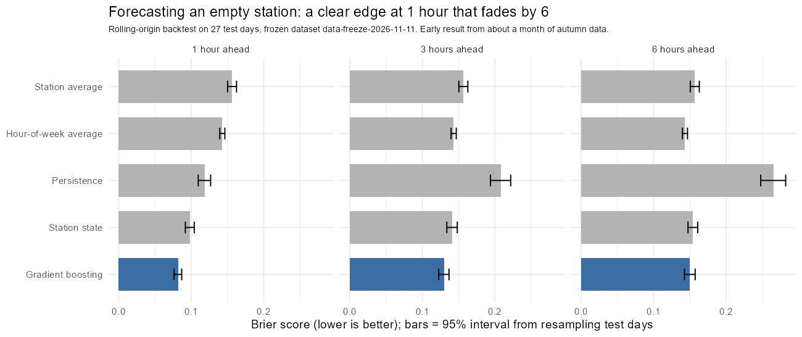
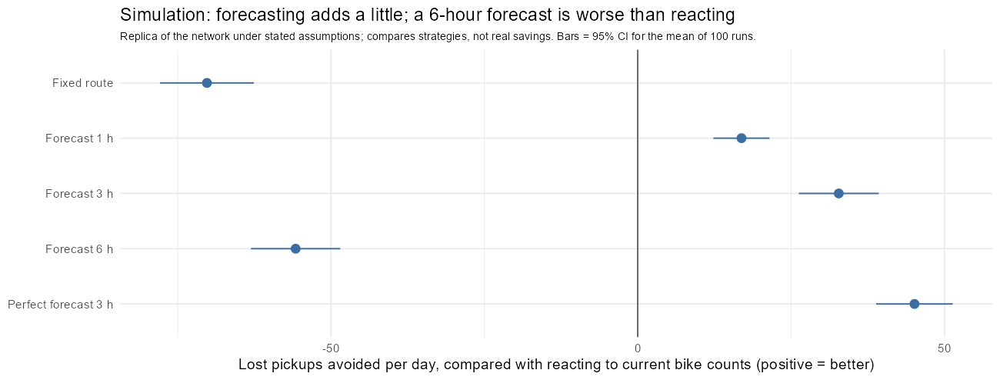
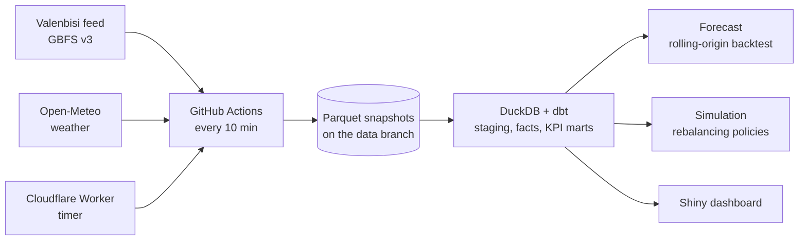

# Valenbisi Inventory Lab

 

**What if a city's bike stations were treated like warehouse inventory?** Bikes are stock, an empty station is a stockout, a full station is a blockout, and the trucks that move bikes are replenishment. This project collects Valencia's live bike-share feed every 10 minutes, models it in SQL (DuckDB + dbt), measures service level, forecasts stockouts, and simulates whether forecasting would improve rebalancing.

**New here? Read the [one-page case study](docs/case_study.md)** (5 minutes). Everything below is produced by scripts in this repo from real collected data.

## The results in 30 seconds
| Question | Answer |
|---|---|
| How bad is service? | Stations are **empty about 13% of the time** and full about 6%, with a strong daily pattern. 30 of 273 stations are empty at least a quarter of the time. |
| Can empty stations be forecast? | **Yes, one hour ahead:** AUC 0.93, and 16.7% better Brier score than the best simple baseline (95% interval 15.9% to 17.5%). The edge fades by 3 hours and is gone by 6. |
| Would forecasts improve rebalancing? | **Only a little.** In a simulation, planning with a 3-hour forecast beats simply reacting to current counts by about 33 lost pickups a day (95% interval 26 to 39), about 1%. **The number of trucks matters far more than forecast quality.** |
| What was surprising about the data? | The feed's `last_reported` timestamp looks like a freshness flag but is not: it changed in only 3.4% of the intervals where bike counts changed. Using it would have discarded 93% of readings, so freshness is judged by how long a count has been frozen. |

### Honest limits
- **33 complete days in one autumn month.** No weather, holiday or seasonal conclusions yet; collection continues and the analysis is re-run at each freeze (15 days, now 33; next at 60 and 90 days). The headline findings held from 15 to 33 days; the size of the simulation effects did not.
- **The simulation compares strategies; it does not measure real savings.** It understates how often stations are empty (7.7% simulated against 12.8% real), and the truck budget is an assumption.
- **No trip or truck data.** Activity is inferred from changes in bike counts, a lower bound on true trips.
- Stockouts shorter than the 10-minute sampling can be missed, so rates are lower bounds.

## Where to look
| If you want... | Read |
|---|---|
| The story in one page | [docs/case_study.md](docs/case_study.md) |
| How I'd explain it in an interview | [docs/interview_script.md](docs/interview_script.md) |
| Findings, one per analysis | [data audit](docs/data_integrity_report.md) · [service level](docs/service_level_findings.md) · [segmentation](docs/segmentation_findings.md) · [forecast](docs/forecast_findings.md) · [simulation](docs/simulation_findings.md) |
| Methods and definitions | [methodology](docs/methodology.md) · [analysis charter](docs/analysis_charter.md) · [dataset card](docs/dataset_card.md) |
| The code | `src/ingest.py` (collector) · `dbt/` (SQL models and tests) · `src/forecast/` · `src/simulate/` · `dashboard/` (Shiny, local) |
| Run it yourself | [docs/reproducing.md](docs/reproducing.md) |
| Project status and roadmap | [docs/master_timeline.md](docs/master_timeline.md) |

## How it works

- **Collection:** a small Python collector stores one parquet file per snapshot. A daily health check raises an issue if collection stalls.
- **Modelling:** dbt models with data tests (no negative counts, capacity arithmetic, no long gaps, and more). CI builds them on a small synthetic sample.
- **Reproducibility:** results come from a frozen, tagged copy of the data (`data-freeze-2026-10-24`), while collection continues on the live branch.
- **Quality rules:** 50 automated tests; no number appears in a document unless a script produced it.

## Data and attribution
Station data: Valenbisi / JCDecaux, JCDecaux Open Licence. Weather: Open-Meteo.com (CC BY 4.0). Code: MIT.
